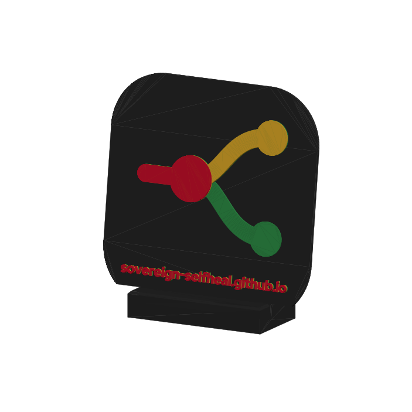
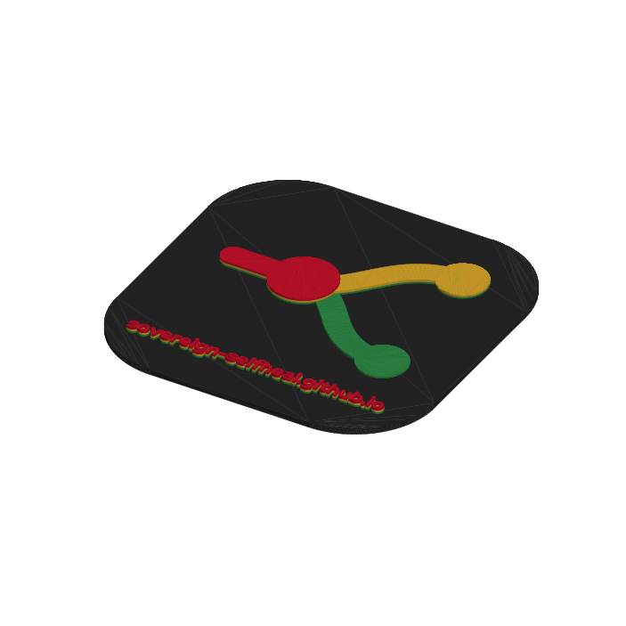
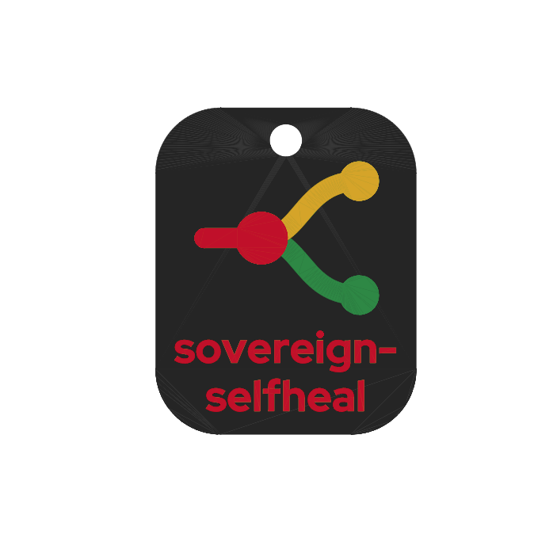

# logo-3d

The logo of the demo **Sovereign Self-Healing: LLM Routing and AI SRE Triage on OpenShift AI**
(<https://sovereign-selfheal.github.io/>) as parts for a 3D printer with one nozzle: a table plaque
with the address of the site, a second plaque with a QR code of the site, keychains (one of them
with the name of the project), a stand for the plaques and a short test print. The model is
written in [build123d](https://github.com/gumyr/build123d) and exported to STL, 3MF and STEP.


The mark is the favicon of the site. A request (the red line) reaches the gateway (the red node),
which sends it to the cloud model (the curve going up) or to the local model (the curve going down).
Its geometry is copied from `favicon.svg` into `src/logo_3d/params.py`.

On the table, the plaque stands in the slot of its stand and leans back by 15 degrees, so the
people in the room can see it:



## Four colors with one nozzle

A printer with one nozzle prints one color per layer. So every colored part of the logo starts on
top of the base and ends at its own height, and the filament changes at the first layer of each
band. Seen from above, every part shows the color of its top layers:

| Layers (0.2 mm) | Height | Spool | What |
|---|---|---|---|
| 1-12 | 0 - 2.4 mm | Prusament PETG Jet Black | the plate |
| 13-16 | 2.4 - 3.2 mm | Prusament PETG Jungle Green | curve and dot of the local model |
| 17-20 | 3.2 - 4.0 mm | Prusament PETG Yellow Gold | curve and dot of the cloud model |
| 21-24 | 4.0 - 4.8 mm | Prusament PETG Lipstick Red | line and node of the gateway, and the address |

The gateway is the highest part, so its node covers the point where the two curves start, as in the
SVG. On the sides of the higher parts you can see thin stripes of the colors below; from the front
they do not show.



The exporter prints this table for the current parameters. All parts with colors use the same
heights, so they can share a plate (for example the plaque and a few keychains).

## The QR plaque


A second plaque carries a QR code of <https://sovereign-selfheal.github.io/>, so the people at the
table can open the site with their phone. It has two colors: a plate of Prusament PETG Signal White
and the code in Jet Black, with one change at layer 13 (2.60 mm). Dark modules on a light plate
are the form that every phone reads; some apps do not read a light code on a dark plate.

The code uses error correction Q, so a reader still decodes it when a quarter of it is damaged,
and it has a light margin of four modules. The plaque is as large and as thick as the logo plaque,
so it stands in a second stand. The code sits half a slot above the centre: the stand hides the
bottom 10 mm of the plaque, and the whole margin stays visible. The tests read the code back from
the solid, module by module, and decode it.

## What you get

| File | What it is |
|---|---|
| `out/plaque.3mf` | the plaque, 140 mm, with the mark and the address of the site |
| `out/keychain.3mf` | a 40 mm keychain with a hole for a key ring; add copies in the slicer |
| `out/keychain_name.3mf` | the same keychain, 40 x 50 mm, with the name of the project under the mark; the same color changes |
| `out/stand.3mf` | the stand: the plaque leans back by 15 degrees; one color, no color change |
| `out/coupon.3mf` | the test print: a ladder of color pads and a sample of the address |
| `out/qr_plaque.3mf` | the QR plaque, 140 mm: a QR code of the site, dark on light |
| `out/*.stl`, `out/*.step` | the same parts as STL (any slicer) and STEP (real surfaces, for CAD) |
| `out/*.png` | colored previews, with `--preview`; `*_on_stand.png` show the plaques in their stands |

  

## Getting started

The project uses [uv](https://docs.astral.sh/uv/); `pip` is not used anywhere.

```bash
uv sync                               # set up the environment
uv run scripts/export.py              # write everything to out/
uv run scripts/export.py --preview    # also write the colored previews
uv run pytest -q                      # check the geometry
```

On Linux, the OpenCascade module behind build123d needs `libGL.so.1` and `libX11.so.6` when Python
imports it, even though nothing is drawn. Without them the import fails with
`ImportError: libGL.so.1: cannot open shared object file`. Install them:

```bash
sudo dnf install mesa-libGL libX11      # Fedora
sudo apt install libgl1 libx11-6        # Debian, Ubuntu
```

## Print it

1. **Test print first.** Print `out/coupon.3mf` and one keychain with the name (its letters are the
   smallest of all the parts), with the color changes below. The
   coupon has a row of pads for each color: from left to right, 1, 2, 3 and 4 layers of that color
   over the colors that are under it in the logo. Check three things:
   - **The changes fall on the right layer.** The first pad of the green row has one layer of
     green. If it is black, the change came one layer late: in the slicer, put all the changes one
     layer lower (12, 16 and 20). If the top of the plate is green, the change came one layer
     early: put them one layer higher (14, 18 and 22).
   - **The colors cover.** Find the thinnest pad that hides the color below. If it is less than 4
     layers, export again with `--band-layers N`: the table of color changes changes too.
   - **The text is easy to read.** Look also at the sides of the letters: they cross the three
     bands, so under the red there are thin green and yellow stripes. Fewer layers per band make
     them thinner.
2. **Load the parts** in PrusaSlicer: printer Prusa MK4 with a 0.4 mm nozzle, the 0.20 mm profile,
   filament Prusament PETG. For more keychains, right-click the keychain and choose "Set number of
   instances", then arrange the plate.
3. **Slice, then add the color changes.** On the vertical slider of the preview, select each layer
   of the table (13, 17 and 21, at 2.60, 3.40 and 4.20 mm) and click the "+" icon. The new color
   starts with that layer; the coupon shows if it does.
4. **Print.** At each change the printer stops and asks for the next filament. Let it purge until
   the new color comes out clean: PETG keeps the old color in the nozzle for longer than PLA.
5. **Print the QR plaque** in the same way, with other spools: start with Signal White and add
   one change only, at layer 13 (2.60 mm), to Jet Black. Scan it with your phone before you take it
   to the event. PETG is shiny: if a lamp reflects on the code, tilt the plaque a little.
6. **Print the stand twice**, one for each plaque, on its own and in one color (black is fine).

| Setting | Suggestion |
|---|---|
| Nozzle / layer height | 0.4 mm / 0.2 mm, first layer 0.2 mm |
| Supports | none: every wall is vertical, and the slot of the stand leans by 15 degrees only |
| Infill | the default of the profile |
| Sheet | textured or satin; on smooth PEI use glue stick, because PETG sticks too well |
| Material | Prusament PETG: all the spools above have the same temperatures (240-260 °C, bed 70-90 °C) |

PETG takes in water from the air and then makes strings and bubbles. If a spool has been open for a
long time, dry it first. A short pass with a hot air gun removes thin strings.

The exporter also prints how much material each part has per color. These figures are for solid
parts: the slicer fills the inside with infill, so it uses less. Let the slicer report the real
figure for your profile.

## Changing the design

Every dimension lives in `src/logo_3d/params.py`, and every one is also an option of the exporter:

```bash
uv run scripts/export.py --band-layers 3            # thinner color bands, after the coupon
uv run scripts/export.py --plaque-size 120          # a smaller plaque
uv run scripts/export.py --keychain-size 35         # smaller keychains
uv run scripts/export.py --slot-clearance 0.4       # a tighter slot in the stand
uv run scripts/export.py --only keychain            # one part only
```

The parameters worth knowing:

| Parameter | Default | What it does |
|---|---|---|
| `layer_height` | 0.2 | layer height of the slicer profile |
| `base_layers` | 12 | layers of the black plate |
| `band_layers` | 4 | layers of each color band |
| `plaque_size` | 140.0 | side of the plaque |
| `address` | `sovereign-selfheal.github.io` | text under the mark |
| `address_width` | 112.0 | width of the text; the font size follows from it |
| `keychain_size` | 40.0 | side of a keychain |
| `name_text` | `sovereign-\|selfheal` | name on the keychain; `\|` starts a new line |
| `ring_hole_dia` | 5.0 | hole for the key ring |
| `slot_lean` | 15.0 | angle of the plaque in the stand, from the vertical |
| `slot_clearance` | 0.6 | gap between the plaque and the slot |
| `qr_url` | `https://sovereign-selfheal.github.io/` | address in the QR code |
| `qr_error` | `q` | error correction of the QR code: `l`, `m`, `q` or `h` |

`Params.validate()` refuses a combination that gives a part you cannot use, for example a keychain so
small that the curves are thinner than four extrusions, or a stand that hides the address.


## Layout

```
src/logo_3d/
├── params.py     every dimension, the mark of the favicon, the spools and the bands
├── mark.py       the mark as flat sketches, one per color
├── parts.py      plaque, keychains, stand, coupon and QR plaque; a plaque in its stand
├── preview.py    colored PNG previews
├── cli.py        the exporter
└── fonts/        Red Hat Display Bold (SIL Open Font License)
scripts/export.py run the exporter from the repository
tests/            checks of the geometry: color bands, fits, printable sizes
docs/             the previews shown in this README
```

## License

Apache License 2.0, see [LICENSE](LICENSE). The font is under the SIL Open Font License 1.1, and the
trademarks are listed in [NOTICE](NOTICE).
